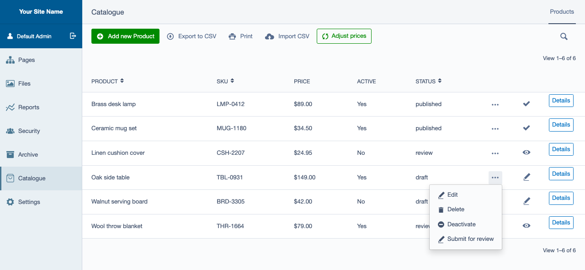
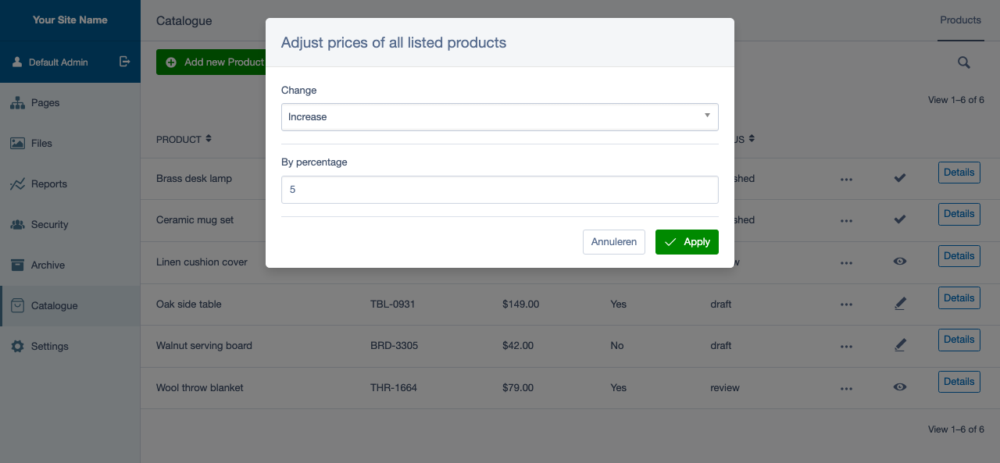
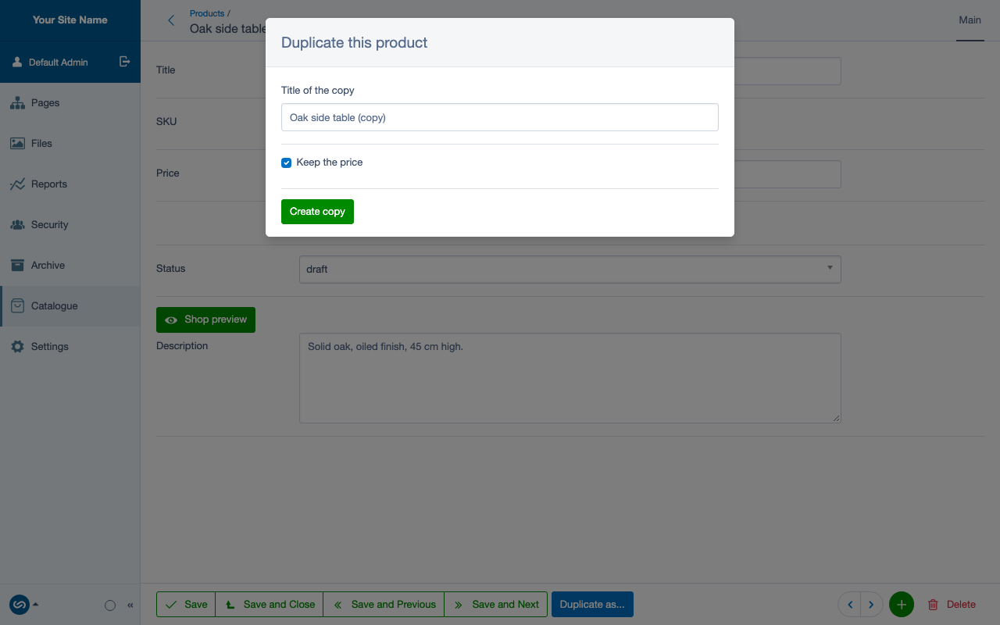
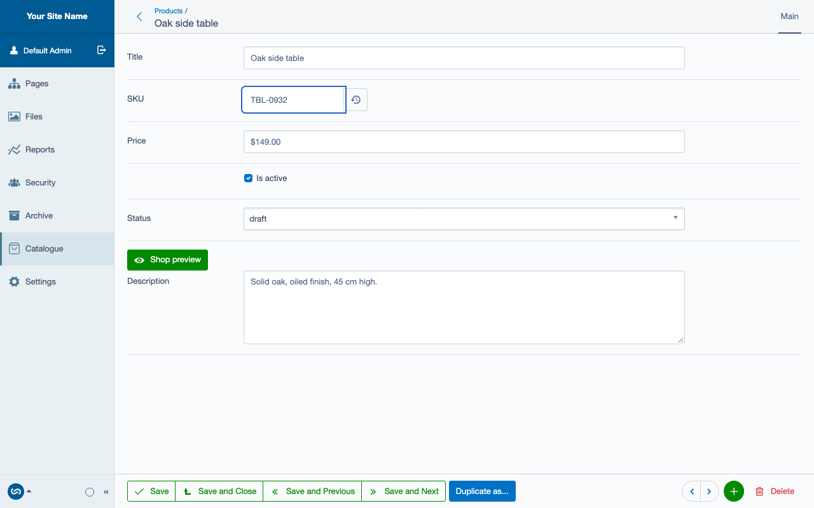

# Simpler Silverstripe

Opt-in helpers that make Silverstripe CMS admin development simpler again: Vue 3 in the CMS
through an import map, a Bootstrap modal you open from JavaScript or PHP, GridField buttons that
open a modal or toggle a field, a text field that has to be unlocked before it can be edited, DOM
events for content the CMS loads later, and one-line session access. For Silverstripe 5 and 6.



*Maintained by [Restruct](https://github.com/restruct). If this module saves you time, you can
[support ongoing maintenance](https://github.com/sponsors/restruct).*

## The CMS has become hard to extend with a little JavaScript

Since Silverstripe 4 the CMS is a mix of React, jQuery Entwine and AJAX (pjax) navigation. The
everyday things a project adds to its admin screens became harder than they need to be:

- **No "page loaded" moment.** Most CMS screens arrive through AJAX or are rendered by React, so
  `DOMContentLoaded` fires once and your plugin never sees the form you navigate to next.
- **No modern way to write a small widget.** Bringing your own Vue means a build pipeline, and every
  module that bundles its own copy ships another 160 KB of the same library.
- **No modal.** The CMS has no dialog you can open from your own code. `lekoala/silverstripe-pure-modal`
  renders its modal inside the CMS form, so a form in that modal becomes a nested form and needs an
  iframe.
- **GridField actions stop at a button.** There is no toolbar button that asks for input first, no
  row button that shows details, and no row button that flips a field.
- **Session access is verbose:** `$this->getRequest()->getSession()->get('key')`, and only where a
  request is at hand.

This module adds those basics back. Only a small core script (about 7 KB) is always loaded; Vue,
the modal and every PHP component are opt-in.

## Helpers, each one opt-in

| Helper | Size | Loaded | Needs |
|--------|------|--------|-------|
| **DOM events**: `DOMNodesInserted` / `DOMNodesRemoved` for content the CMS inserts later | ~7 KB | Always | - |
| **Vue 3 import map**: `import { createApp } from 'vue'` in your own ES modules and templates | ~162 KB (prod build) | Opt-in | `AdminExtension` on `LeftAndMain` |
| **Modal dialog**: Bootstrap modal through the global `simpler.modal` object | ~42 KB | Opt-in | Vue import map |
| **Edit-form modal buttons**: `SimplerModalField`, `SimplerModalAction` (drop-in for PureModal) | - | When used | Modal, `lekoala/silverstripe-pure-modal` |
| **GridField modal buttons**: `GridFieldToolbarModalAction`, `GridFieldModalButton` | - | When used | Modal |
| **GridField toggle buttons**: `GridFieldToggleFieldButton`, `GridFieldToggleIsActiveButton` | - | When used | - (core script only) |
| **`EditProtectedTextField`**: read-only until unlocked | - | When used | Vue import map |
| **`Session`**: static session helpers | - | PHP only | - |
| **`HeadRequirements`**: import maps and early scripts in `<head>` | - | PHP only | - |

Sizes are those of the files in `client/dist`. In total:

- DOM events only: ~7 KB (always loaded)
- Import map with Vue only: ~7 KB + 162 KB = **~169 KB** (for your own Vue components)
- Modal: ~7 KB + 162 KB + 42 KB = **~211 KB**

In dev mode (`SS_ENVIRONMENT_TYPE=dev`) the import map points at Vue's development build (~530 KB,
with warnings and devtools support) instead of the production build.

### Switching on Vue 3 (and with it the modal)

Everything built on Vue, the modal and the fields and buttons that use it as much as your own
components, needs the import map **on the first, full page load of the CMS**. Add the extension to
`LeftAndMain`:

```yaml
# app/_config/config.yml
SilverStripe\Admin\LeftAndMain:
  extensions:
    - Restruct\Silverstripe\Simpler\AdminExtension
```

The modal's PHP classes (`SimplerModalField`, `SimplerModalAction`, `GridFieldToolbarModalAction`,
`GridFieldModalButton`) load the modal script themselves, but **not** the import map: a browser only
accepts an import map that is in the page before the first module script, so it cannot be added
when a form arrives later through AJAX. Without the extension these classes raise a PHP warning
("Vue import map not available"), and the modal does not open. `EditProtectedTextField` raises no
warning; it simply stays a plain read-only input.

## Vue 3 in your own CMS code

With `AdminExtension` applied, Vue is available to any ES module on the page as
`import { createApp } from 'vue'`, without bundling it. The extension picks the dev build (with
warnings and devtools) or the prod build by environment.

### Option A: a self-contained ES module file

Create a JS file (not webpack-bundled) and load it as a module:

```js
// mymodule/client/dist/js/my-vue-app.js
import { createApp, ref } from 'vue';

document.addEventListener('DOMContentLoaded', () => {
    createApp({
        setup() {
            const count = ref(0);
            return { count };
        },
        template: `<button @click="count++">Clicked {{ count }} times</button>`
    }).mount('#my-app');
});
```

Load it through Requirements with `type="module"`:

```php
use SilverStripe\View\Requirements;

Requirements::javascript('mymodule/client/dist/js/my-vue-app.js', ['type' => 'module']);
```

### Option B: inline in a Silverstripe template

Mix Silverstripe template tags directly with Vue, which is ideal for handing server data to a
component:

```html
<%-- templates/Includes/MyWidget.ss --%>
<script type="module">
import { createApp } from 'vue'

createApp({
    data() {
        return {
            apiBase: $Ctrl.Link('api').JSON.RAW,
            items: $Items.JSON.RAW,
            currentItem: {
                id: $CurrentItem.ID.JSON,
                title: "$CurrentItem.Title.JS",
                isActive: $CurrentItem.IsActive.JSON.RAW,
            }
        }
    },
    methods: {
        async saveItem() {
            const response = await fetch(this.apiBase + '/save', {
                method: 'POST',
                headers: { 'Content-Type': 'application/json' },
                body: JSON.stringify(this.currentItem)
            });
            // handle response...
        }
    }
}).mount('#my-widget-$ID')
</script>

<div id="my-widget-$ID">

    <h3>{{ currentItem.title }}</h3>

    <ul>
        <li v-for="item in items" :key="item.ID">
            {{ item.Title }}
            <% if $ShowExtra %>
                <span class="extra">$ExtraInfo</span>
            <% end_if %>
        </li>
    </ul>

    <button @click="saveItem" class="btn btn-primary">
        {$T('Save')}
    </button>

</div>
```

**Key patterns:**
- Use `$Variable.JSON.RAW` for objects/arrays/booleans (raw JSON, no escaping)
- Use `"$Variable.JS"` for strings (JS-escaped, in quotes)
- Use `$ID` or `$HexID` to make element IDs unique when the template is used more than once
- Mix `<% if %>` Silverstripe conditionals with Vue directives as needed
- Use `{$T('Label')}` or `$fieldLabel('Name')` for translated strings in HTML

> **Entwine compatibility note:** Vue components inside CMS forms can trigger Entwine's
> MutationObserver bug (`el.getAttribute is not a function`). The core script suppresses that
> error; see [The Entwine and Vue conflict](#the-entwine-and-vue-conflict) below.

## A modal you open from JavaScript or PHP



`simpler-modal.js` puts one Bootstrap modal, driven by Vue, on the page as `simpler.modal`. Set its
properties and it shows.

**Silverstripe 5 and 6.** The CMS ships Bootstrap 4 CSS on Silverstripe 5 and Bootstrap 5 CSS on
Silverstripe 6. `simpler-modal.js` bundles both modal implementations and picks the one matching
the page's CSS at runtime, so the same code works on either. To close the modal from HTML you put in
`bodyHtml`, use `data-simpler-dismiss` (Bootstrap's own `data-dismiss="modal"` and
`data-bs-dismiss="modal"` are honoured on both majors too).

The PHP classes below (`SimplerModalField`, `SimplerModalAction` and the GridField buttons) load
the modal script themselves. To use `simpler.modal` from your own JS, load it in one of two ways,
with [the import map switched on](#switching-on-vue-3-and-with-it-the-modal) either way:

**Option A: from PHP** (in your controller or extension):

```php
use Restruct\Silverstripe\Simpler\AdminExtension;

AdminExtension::requireImportMap();
AdminExtension::requireModal();
```

Use `requireModal()` rather than your own `Requirements::javascript(..., ['type' => 'module'])` for
the modal: when the screen is reached through CMS navigation (menu, tab or breadcrumb, all AJAX), the
admin loads the response's scripts as classic scripts, where a module fails ("Cannot use import
statement outside a module"). In an AJAX request `requireModal()` therefore adds
`simpler-modal-loader.js`, a classic script that imports the module (and does nothing when the modal is
already on the page). The import map still has to be on the page from the first full load, which is
what AdminExtension on LeftAndMain does; `requireImportMap()` alone only helps on a full page load.

**Option B: from YAML config** (loaded on every CMS page):

```yaml
# app/_config/config.yml
SilverStripe\Admin\LeftAndMain:
  extensions:
    - Restruct\Silverstripe\Simpler\AdminExtension
  simpler_include_modal: true
```

### Basic usage

```js
simpler.modal.title = 'My Dialog';
simpler.modal.bodyHtml = '<p>Hello world!</p>';
simpler.modal.show = true;
```

### All options

```js
simpler.modal.title = 'Confirm Action';
simpler.modal.bodyHtml = '<p>Are you sure?</p>';
simpler.modal.closeBtn = true;      // Show footer close button (default: false; the header X is always there)
simpler.modal.closeTxt = 'Cancel';  // Close button text (default: "Close")
simpler.modal.saveBtn = true;       // Show primary button (default: false)
simpler.modal.saveTxt = 'Confirm';  // Primary button text (default: "Save")
simpler.modal.onSave = () => {};    // Called when the primary button is clicked (default: null)
simpler.modal.static = true;        // Prevent closing via backdrop/Escape (default: false)
simpler.modal.size = 'lg';          // 'sm', 'lg', 'xl' or custom like '800px', '90vw' (default: null)
simpler.modal.show = true;
```

Close it again with `simpler.modal.show = false`.

### Loading content via AJAX

```js
simpler.modal.title = 'Loading...';
simpler.modal.bodyHtml = simpler.spinner;  // Built-in loading spinner
simpler.modal.show = true;

jQuery.get('/my/ajax/endpoint', function(html) {
    simpler.modal.bodyHtml = html;
    simpler.modal.title = 'Content Loaded';
});
```

All properties reset to their defaults when the modal is closed.

### Any button can open it

Every element with a `data-simpler-modal` attribute holding the modal's options as JSON opens the
modal when clicked; this is what the PHP classes below render:

```html
<button type="button" data-simpler-modal='{"title":"Preview","bodyHtml":"<iframe src=\"/admin/preview/123\"..."}'>
    Preview
</button>
```

A generic click handler in `simpler-modal.js` parses this config and opens the modal:

```js
document.addEventListener('click', (e) => {
    const btn = e.target.closest('[data-simpler-modal]');
    if (!btn) return;

    const config = JSON.parse(btn.dataset.simplerModal);
    Object.assign(simpler.modal, config);
    simpler.modal.show = true;
});
```

## Modal buttons in edit forms (a drop-in for PureModal)



`SimplerModalField` and `SimplerModalAction` extend the `lekoala/silverstripe-pure-modal` classes but
render through `simpler.modal` instead of PureModal's CSS checkbox mechanism.

> **Requires `lekoala/silverstripe-pure-modal`**, which this module only suggests:
> `composer require lekoala/silverstripe-pure-modal` (`^1.2` on Silverstripe 5, `^2` on Silverstripe 6).
> Without it the two classes are not defined.

### How it differs from PureModal

PureModal renders inside the CMS form (as a FormField), which means a form in the modal becomes a
nested form (invalid HTML). PureModal works around this with an iframe.

SimplerModal takes a different approach: the modal is appended to `document.body`, outside the CMS
form, so a form inside it works without an iframe. This lets `SimplerModalAction` render an actual
Silverstripe form that submits directly.

### Usage

```php
use Restruct\Silverstripe\Simpler\SimplerModalField;
use Restruct\Silverstripe\Simpler\SimplerModalAction;

// Iframe content (e.g., preview) with extra large modal
SimplerModalField::create('preview', 'Preview')
    ->setIframeSrc('/admin/preview/123')
    ->setIframeHeight('80vh')   // default: 70vh
    ->setModalSize('xl')        // 'sm', 'lg', 'xl' or custom like '800px', '90vw'
    ->setCloseBtn(true)         // Show a footer close button (default: false, the header X is always there)
    ->setButtonIcon('eye')      // font-icon-eye; setButtonIcon('file-pdf', 'bs') gives Bootstrap Icons' bi bi-file-pdf
    ->addExtraClass('btn-outline-info');

// HTML content with custom width
SimplerModalField::create('info', 'Info')
    ->setContent('<p>Some information here</p>')
    ->setModalSize('600px');

// Custom dialog title (different from button text)
SimplerModalField::create('details', 'Show Details')
    ->setDialogTitle('Item Details')
    ->setContent($myHtmlContent);

// CMS action with form fields (form submits directly - no iframe!)
SimplerModalAction::create('translate', 'Translate')
    ->setFieldList(FieldList::create([
        DropdownField::create('lang', 'Language', ['en' => 'English', 'nl' => 'Dutch']),
        TextareaField::create('notes', 'Notes'),
    ]))
    ->setModalTitle('Translate this page')      // Dialog title (default: the submit button's title)
    ->setDialogButtonTitle('Start Translation');
```

`SimplerModalAction` also takes `setModalSize()` and `setButtonIcon()`. The modal's form posts only
its own fields to the record's edit form, through `lekoala/silverstripe-cms-actions`
(`doCustomAction`). The record method (here `translate($data)`) gets that data alone: the edit form
is neither validated nor saved for this request, so the method validates its own input. For this
the action adds a hidden, validation-exempt stand-in button to the edit form
(`SimplerModalExemptAction`, rendered as nothing).

### Migration from PureModal

The classes extend PureModal's, so the API is the same; change the imports:

```php
// Change from:
use LeKoala\PureModal\PureModal;
use LeKoala\PureModal\PureModalAction;

// To:
use Restruct\Silverstripe\Simpler\SimplerModalField as PureModal;
use Restruct\Silverstripe\Simpler\SimplerModalAction as PureModalAction;
```

## Modal and toggle buttons for GridFields

Three GridField components that neither `lekoala/silverstripe-pure-modal` nor
`lekoala/silverstripe-cms-actions` provide: PureModalAction only works in detail forms, and
GridFieldTableButton only supports the browser's own `prompt()` / `confirm()` dialogs. The first
screenshot at the top of this page shows all three.

### GridFieldToolbarModalAction: a toolbar button with a form in a modal

A toolbar button that opens a modal with form fields, submitted through GridField action routing.
Extend it and override `handleAction()`:

```php
use Restruct\Silverstripe\Simpler\GridFieldToolbarModalAction;

class MyGridFieldAction extends GridFieldToolbarModalAction
{
    public function __construct()
    {
        parent::__construct('myaction', 'Do Something');
        $this->setDialogTitle('Configure Action');   // default: the button label
        $this->setSubmitLabel('Apply');              // default: "Submit"
        $this->setButtonIcon('rocket');
        $this->setFieldList(FieldList::create([
            DropdownField::create('Option', 'Choose', $options),
            NumericField::create('Count', 'How many'),
        ]));
    }

    public function handleAction(GridField $gridField, $actionName, $arguments, $data)
    {
        if ($actionName !== 'myaction') {
            return;
        }
        $option = $data['Option'] ?? null;
        $count = (int) ($data['Count'] ?? 1);
        // Do something with the form data...
    }
}

// Add to GridField config:
$config->addComponent(new MyGridFieldAction());
```

The modal shows a progress bar while the request runs. Other options: `setButtonClasses()` (default
`btn btn-outline-primary`), `setModalSize()`, `setTargetFragment()` (default `buttons-before-left`)
and `setActionArguments()`.

**View-only mode.** Without a field list, but with `setIframeSrc()` or `setBodyHtml()`, the button
opens the content instead of a form, without a submit button:

```php
// Iframe content (e.g., a PDF viewer):
$config->addComponent(
    GridFieldToolbarModalAction::create('viewpdf', 'View PDF')
        ->setIframeSrc('/path/to/document.pdf')
        ->setIframeHeight('85vh')                   // default: 70vh
        ->setModalSize('60vw')
        ->setButtonIcon('file-pdf', 'bs')           // 'ss' (default) = font-icon-, 'bs' = bi bi-
        ->setButtonClasses('btn btn-outline-info')
);

// HTML content:
$config->addComponent(
    GridFieldToolbarModalAction::create('preview', 'Preview')
        ->setBodyHtml('<div class="preview">...</div>')
);
```

**Key difference from SimplerModalAction:**
- `SimplerModalAction` is for DataObject edit forms (`getCMSActions()`)
- `GridFieldToolbarModalAction` is for GridField toolbars (action routing via StateID)

#### Error handling

The AJAX handler reads the response body on HTTP errors and displays it in the modal. Throw
`HTTPResponse_Exception` to show a meaningful error:

```php
use SilverStripe\Control\HTTPResponse;
use SilverStripe\Control\HTTPResponse_Exception;

// In handleAction():
try {
    // ... do work
} catch (\Exception $e) {
    throw new HTTPResponse_Exception(new HTTPResponse($e->getMessage(), 422));
}
```

#### Full page reload (X-Reload header)

By default, on success the modal reloads only the parent GridField. To force a full page reload
(e.g., when other tabs also need refreshing), set the `X-Reload` header:

```php
Controller::curr()->getResponse()->addHeader('X-Reload', 'true');
```

### GridFieldModalButton: a view-only modal per row

For per-row buttons in a GridField column that open a view-only modal:

```php
use Restruct\Silverstripe\Simpler\GridFieldModalButton;

class MyDetailButton extends GridFieldModalButton
{
    protected function getButtonLabel(DataObject $record): string
    {
        return 'Details';
    }

    protected function getModalTitle(DataObject $record): string
    {
        return 'Details for ' . $record->Title;
    }

    protected function getModalContent(DataObject $record): string
    {
        return '<p>' . htmlspecialchars($record->Description) . '</p>';
    }

    protected function shouldShowButton(DataObject $record): bool
    {
        return $record->canView();
    }
}

// Add to GridField config:
$config->addComponent(new MyDetailButton());
```

`getModalContent()` returns HTML: escape record values yourself, as above.

Options (all fluent): `setColumnName()` (default `ModalAction`), `setButtonClasses()` (default
`btn btn-sm btn-outline-info`), `setModalSize()` (`sm`/`lg`/`xl` or a CSS width), `setShowCloseButton()`
(default `true`) and `setCloseButtonText()` (default `Sluiten`, Dutch for "Close": set it for an
English or other admin).

The button is rendered inside `<span class="action">`: the `.action` ancestor keeps a click from
opening the row's record, while the button itself must not carry `action`, because silverstripe/admin
turns every `.grid-field .action` button into an AJAX GridField reload (#5, changed in 1.0.0).

### GridFieldToggleFieldButton: a row button that cycles a field

For per-row buttons that cycle a field through values (boolean or multi-state). The click posts
through the GridField and re-renders the list in place. The toggle is also an item of the row's
action menu (the "..." button), where the admin puts it by default (column `Actions`); give it its
own column with `setColumnName()` to also show it as an icon button in the row, like the status
column in the screenshot at the top.

```php
use Restruct\Silverstripe\Simpler\GridFieldToggleFieldButton;
use Restruct\Silverstripe\Simpler\GridFieldToggleIsActiveButton;

// Simple boolean toggle for IsActive field (pre-configured: Activate / Deactivate, asks "Are you sure?")
$config->addComponent(GridFieldToggleIsActiveButton::create());

// Generic boolean toggle for any field
$config->addComponent(GridFieldToggleFieldButton::create('IsPublished'));

// Multi-state toggle (cycles through values in order)
$config->addComponent(
    GridFieldToggleFieldButton::create('Status')
        ->setColumnName('StatusToggle')   // own column, besides the action menu item
        ->setStates([
            'draft' => ['icon' => 'edit', 'title' => 'Submit for Review'],
            'review' => ['icon' => 'eye', 'title' => 'Publish'],
            'published' => ['icon' => 'check-mark', 'title' => 'Archive'],
            'archived' => ['icon' => 'archive', 'title' => 'Reset to Draft'],
            // Optional per state: 'buttonClass' => '...', and 'iconPrefix' => 'bs' for Bootstrap
            // Icons ('ss', the default, is font-icon-; false is no prefix)
        ])
        ->setConfirmMessage('Change status?')
);
```

**Advanced options:**

```php
GridFieldToggleFieldButton::create('IsActive')
    // Custom state rendering via callback
    ->setStateRenderer(function(DataObject $record, $currentValue) {
        return [
            'icon' => $record->getStatusIcon(),
            'title' => $record->getNextStatusLabel(),
            'buttonClass' => $currentValue ? 'text-success' : 'text-muted',
        ];
    })
    // Visibility check
    ->setShouldShow(fn($record) => $record->canEdit())
    // Custom toggle logic (called before save)
    ->setToggleAction(function(DataObject $record, $newValue) {
        $record->IsActive = $newValue;
        $record->StatusChangedDate = DBDatetime::now();
        $record->StatusChangedBy = Security::getCurrentUser()->ID;
    })
    // Confirmation dialog
    ->setConfirmMessage('Are you sure?')
    // Use writeWithoutVersion() for versioned records (default: true)
    ->setWriteWithoutVersion(true);
```

## A text field that has to be unlocked first



`EditProtectedTextField` is a `TextField` that starts read-only, with an edit button next to it. For
values an editor should not change in passing, such as a code, an external ID or a slug.

```php
use Restruct\Silverstripe\Simpler\EditProtectedTextField;

// In getCMSFields():
$fields->replaceField('SKU', EditProtectedTextField::create('SKU', 'SKU'));
```

- The edit button makes the input editable; it then turns into a cancel button.
- Once the value is changed, the cancel button becomes a revert button.
- Cancel or revert restores the original value and makes the input read-only again.
- An empty value shows a dash placeholder.

It is a small Vue component, so it needs [the import map](#switching-on-vue-3-and-with-it-the-modal).

## DOM events for content the CMS loads later

The core script, always loaded in the CMS, fires `DOMNodesInserted` whenever content appears, whether
on page load, through AJAX or rendered by React, so you can initialise your own plugins on it:

```js
document.addEventListener("DOMNodesInserted", function(event) {
    console.log('Type:', event.detail.type); // LOAD, MUTATION, MOUNT, UNMOUNT
    console.log('Target:', event.target);

    // Initialize your plugins on new content
    initMyPlugin();
});

document.addEventListener("DOMNodesRemoved", function(event) {
    // Cleanup when content is removed
    destroyMyPlugin();
});
```

**Event types:**
- `LOAD` - Initial DOMContentLoaded
- `MUTATION` - MutationObserver detected DOM changes (batched, at most one event per 100 ms)
- `MOUNT` - React Form component mounted (on specific element)
- `UNMOUNT` - React Form component will unmount

**Note:** An `xhr_buffer` element (`<template id="xhr_buffer">`) is automatically created on page
load. This hidden element is used to parse AJAX HTML through jQuery before inserting it into
Vue/DOM, which triggers Entwine-style listeners that don't fire when content is inserted directly by
Vue.

### jQuery `$` alias (opt-in)

This module does not set `window.$` (anymore, to avoid conflicts); the CMS provides `window.jQuery`.
If you want the `$` shorthand, either:

1. Add to your own JS file: `window.$ = window.$ || window.jQuery;`
2. Or use Requirements: `Requirements::customScript('window.$ = window.$ || window.jQuery;', 'jquery-alias');`

## Session access in one line

```php
use Restruct\Silverstripe\Simpler\Session;

// Instead of: $this->getRequest()->getSession()->get('key')
$value = Session::get('key');
Session::set('key', 'value');
Session::clear('key');
Session::clear_all();
Session::add_to_array('key', 'value');
$all = Session::get_all();
```

The helpers use the session of the current request (`Controller::curr()->getRequest()->getSession()`),
looked up on every call, so they also follow the request in a long-running process (queue runner,
worker). Before 1.0.3 the first session was kept for the rest of the process (#7). Without a current
controller (a shutdown function, a queued job run after the request) they use the request registered
with the Injector if it has a session, and otherwise the session they used last.

## Import maps and early scripts in `<head>`: HeadRequirements

For scripts that must be in `<head>` (import maps, early config):

```php
use Restruct\Silverstripe\Simpler\HeadRequirements;

// Import map entries (browsers allow only ONE import map - these accumulate)
HeadRequirements::import_map('vue', 'restruct/silverstripe-simpler:client/dist/js/vue.esm-browser.js');
HeadRequirements::import_map('lodash', 'https://cdn.jsdelivr.net/npm/lodash-es@4/lodash.min.js');

// JavaScript file in <head>
HeadRequirements::javascript('mymodule:client/dist/js/early-script.js');
HeadRequirements::javascript('https://cdn.example.com/lib.js', ['defer' => true]);

// Inline script in <head>
HeadRequirements::custom_script('window.CONFIG = { debug: true }', 'my-config');
```

Also available as template globals: `$HeadReq_importMap()`, `$HeadReq_javascript()` (alias
`$HeadReq_js()`) and `$HeadReq_customScript()`.

## Technical

### Requirements

* Silverstripe 5 or 6 (`silverstripe/framework ^5 || ^6`)
* PHP 8.1 or newer
* Optional: `lekoala/silverstripe-pure-modal` for `SimplerModalField` / `SimplerModalAction`
  (`^1.2` on Silverstripe 5, `^2` on Silverstripe 6)

### Installation

```
composer require restruct/silverstripe-simpler
```

Then [switch on the import map](#switching-on-vue-3-and-with-it-the-modal) if you use anything
built on Vue.

### Version compatibility

| Branch | Module version | Silverstripe | PHP |
|--------|----------------|--------------|-----|
| `main` | `1.x` | `^5 \|\| ^6` | `^8.1` |
| `ss5` | `0.3.x` | `^4 \|\| ^5` | as Silverstripe requires |
| (tags only) | `0.1.9` | `^4 \|\| ^5` (Vue 2, legacy) | as Silverstripe requires |

`main` is the maintained line: one release line serves both Silverstripe 5 and 6, so there is no
separate Silverstripe 6 branch. Silverstripe 4 reached end of life in April 2025 and is no longer
supported or tested here; projects still on it can stay on the `0.x` tags, which remain available.
Upgrading from 0.3.x: see [UPGRADING.md](UPGRADING.md) and [CHANGELOG.md](CHANGELOG.md).

**`composer.json` is the source of truth** for exact constraints; this table is a quick reference.

### Configuration summary

| Config | Set on | Default | Effect |
|--------|--------|---------|--------|
| `extensions: [AdminExtension]` | `SilverStripe\Admin\LeftAndMain` | not applied | Vue 3 import map in the CMS `<head>` (dev or prod build by environment) |
| `simpler_include_modal` | `SilverStripe\Admin\LeftAndMain` | `false` | With AdminExtension applied: also load `simpler-modal.js` on every CMS page |
| `skip_import_map_check` | `Restruct\Silverstripe\Simpler\AdminExtension` | `false` | Silence the warning the modal classes raise when the import map was not set up on page load |
| `extra_requirements_javascript` / `_css` | `SilverStripe\Admin\LeftAndMain` | set by this module | Core bundle and stylesheet, always loaded in the CMS |

```yaml
# Default (auto-applied by module):
SilverStripe\Admin\LeftAndMain:
  extra_requirements_javascript:
    - 'restruct/silverstripe-simpler:client/dist/js/simpler-silverstripe.js'

# Option 1: Import Map + Modal (via AdminExtension with simpler_include_modal)
# Best for: Using both your own Vue components AND the modal via JS
SilverStripe\Admin\LeftAndMain:
  extensions:
    - Restruct\Silverstripe\Simpler\AdminExtension
  simpler_include_modal: true

# Option 2: Import Map only (via AdminExtension)
# Best for: Using Vue 3 in your own ES modules, EditProtectedTextField, and the modal PHP classes
# (they load the modal script themselves)
SilverStripe\Admin\LeftAndMain:
  extensions:
    - Restruct\Silverstripe\Simpler\AdminExtension

# Option 3: Modal via JS only (without PHP classes)
SilverStripe\Admin\LeftAndMain:
  extensions:
    - Restruct\Silverstripe\Simpler\AdminExtension
  extra_requirements_javascript:
    - 'restruct/silverstripe-simpler:client/dist/js/simpler-modal.js': { type: module }
```

### Development

#### Working on a local checkout

Require the module in a host project through a Composer **path repository with `"symlink": true`**
(as for the tests, below), and run Composer from the project root. Silverstripe's class manifest
finds the module's classes at runtime even when Composer does not know about a checkout, but
PHPUnit loads test classes through Composer's autoloader, before Silverstripe boots, so a checkout
Composer does not know cannot run its tests.

#### Building assets

```bash
cd silverstripe-simpler
yarn install
yarn run dev        # Watch mode
yarn run production # Production build
yarn test           # Modal smoke test (jsdom) against the Bootstrap 4 and 5 paths
```

`client/dist` is committed; CI rebuilds it and fails if it differs from what `client/src` produces.

#### Tests

The PHP tests need a Silverstripe host project (they cannot run from the module directory alone).
Require the module there through a Composer **path repository with `"symlink": true`** - `/tests` is
`export-ignore`, so a dist install has no tests - plus `silverstripe/recipe-testing` and, for the modal
field tests, `lekoala/silverstripe-pure-modal`. `.github/workflows/ci.yml` builds exactly such a host
for each supported Silverstripe major and is the reference setup.

Browser tests (Playwright) for every CMS feature above are in `tests/browser/`; the screenshots in
this README are generated from `tests/browser/screenshots/`, see its README.

### The Entwine and Vue conflict

Vue components in CMS forms can trigger `TypeError: el.getAttribute is not a function`, because
Entwine's MutationObserver does not filter out non-Element nodes.

**Solution:** the core script (`simpler-silverstripe.js`) suppresses that specific error, which lets
Vue work in CMS forms. See [docs/ENTWINE_VUE_CONFLICT.md](docs/ENTWINE_VUE_CONFLICT.md) for details,
alternatives, and future investigation options.

### Changelog and license

[CHANGELOG.md](CHANGELOG.md), upgrade notes in [UPGRADING.md](UPGRADING.md). MIT licensed, see
[LICENSE](LICENSE).
